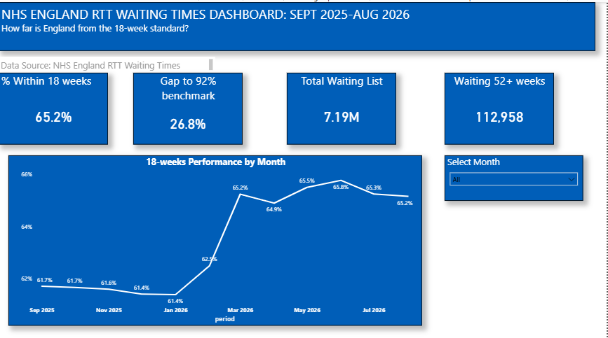
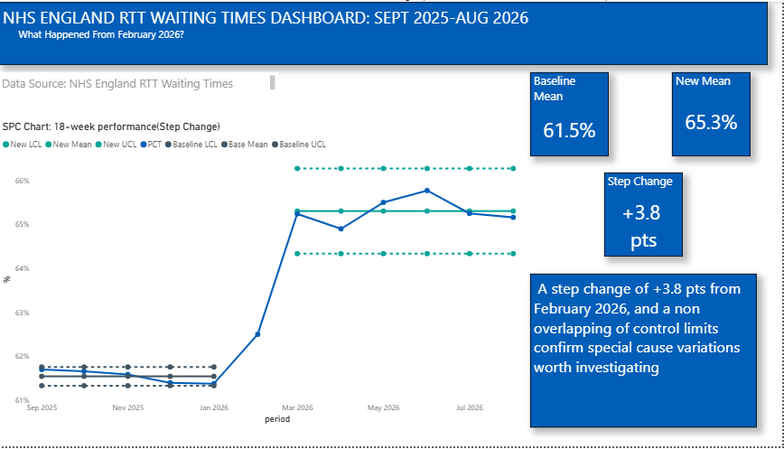
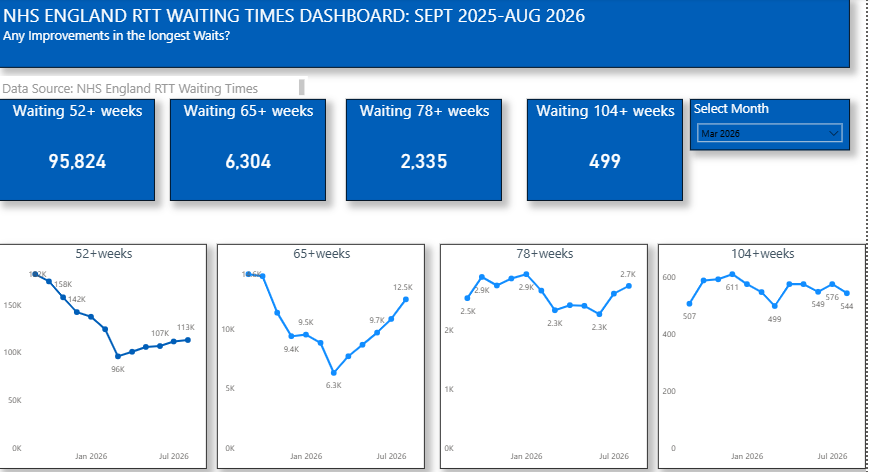
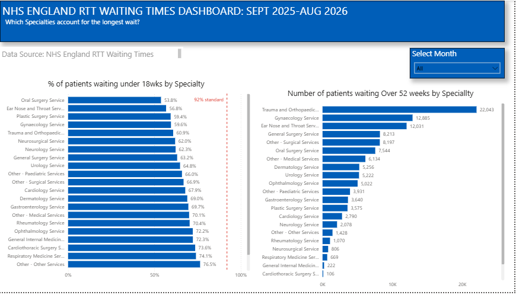
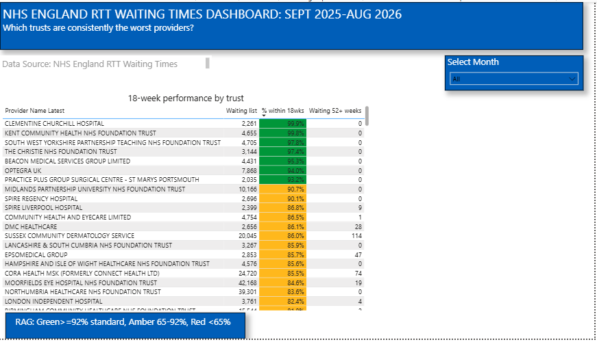

# NHS England 18-Week RTT Performance Analysis (Sep 2025 – Aug 2026)

**How far is England from the 18-week referral-to-treatment standard, and which specialties and providers account for most of the gap?**



## Key findings
- **National performance improved but remains below target.** The share of patients waiting 18 weeks or less rose from **61.7%** (Sep 2025) to **65.2%** (Aug 2026), meeting the 2025/26 interim target of 65% but 4.8 points short of the 70% target for March 2027 and well below the 92% constitutional standard.
- **A sustained step change from March 2026.** SPC (XmR) analysis shows special cause variation: the mean rose from 61.5% (Sep 2025–Jan 2026) to 65.3% (Mar–Aug 2026), a +3.8 percentage-point shift with non-overlapping control limits. Performance has plateaued since March.
- **Long waits are concentrated in a few specialties.** Trauma & Orthopaedics, Gynaecology and ENT account for **41.6%** of patients waiting over 52 weeks, and all three are among the five lowest-performing specialties against the 18-week standard.
- **Very long waits fell, then partly rebounded.** 52+ week waits fell 47% from September 2025 to March 2026 (181,947 → 95,824) before rising to 112,958 in August 2026, still 38% below the September level.
- **The worst-performing specialty differs significantly from the rest.** Oral Surgery (53.8%) trails all other specialties combined (65.7%) by 11.9 percentage points (95% CI 11.7–12.1).

## Data
- **Source:** [NHS England Consultant-led RTT Waiting Times](https://www.england.nhs.uk/statistics/statistical-work-areas/rtt-waiting-times/), monthly full extracts, September 2025 to August 2026.
- **Scope:** incomplete pathways (patients still waiting at month end), 615,185 rows after cleaning, 547 provider codes (532 in August 2026) and 23 treatment functions.
- The raw data is not included in this repository because of its size. Download the 12 monthly full extract CSVs from the link above and place them in a `data/` folder to re-run the notebooks.

## Methods
1. **Cleaning and validation (Python, pandas).** Combined 12 monthly files, removed the all-specialty total rows (C_999), treated blank week bands as zero, and confirmed weekly bands sum to reported totals. Providers were identified by organisation code; where a provider was renamed during the year, its most recent name is shown.
2. **18-week performance** = patients in the 0–18 week bands ÷ total waiting.
3. **Statistical Process Control.** XmR chart of monthly national performance to distinguish genuine process change from routine variation.
4. **Confidence intervals.** 95% Wilson score intervals for specialty and national proportions, plus a difference-in-proportions comparison for the worst-performing specialty.
5. **Dashboard (Power BI).** Six pages: national trend, step change, long waits, specialties, providers and statistical significance.

## Repository structure
```
├── notebooks/
│   ├── 01_cleaning_and_analysis.ipynb
│   ├── 02_statistical_process_control.ipynb
│   └── 03_confidence_intervals.ipynb
├── powerbi/      NHS_RTT_Dashboard_2025-26.pbix
├── report/       RTT_EXECUTIVE_SUMMARY.pdf
└── images/       dashboard screenshots
```

## Dashboard pages
| Step change | Long waits |
|---|---|
|  |  |
| **Specialties** | **Providers** |
|  |  |

## Limitations
- Aggregate counts only: no patient-level data on clinical urgency, demographics or outcomes.
- Monthly snapshots cannot be summed across months, as the same patient appears in several.
- SPC phases contain only 5–6 points, so control limits are provisional. The data shows *that* performance changed, not *why*; waiting-list validation around the March 2026 target deadline may have contributed.
- Confidence intervals reflect binomial variation only.

## Tools
Python (pandas, NumPy, Matplotlib) · Jupyter · Power BI · Statistical Process Control · Wilson confidence intervals

## Author
**Emeka Chukwuma**, (51) B.Pharm (Benin), MSc Advanced Health Informatics (Swansea), building toward a career in health data analysis and data engineering.

📄 [Read the full executive summary](report/RTT_EXECUTIVE_SUMMARY.pdf)
